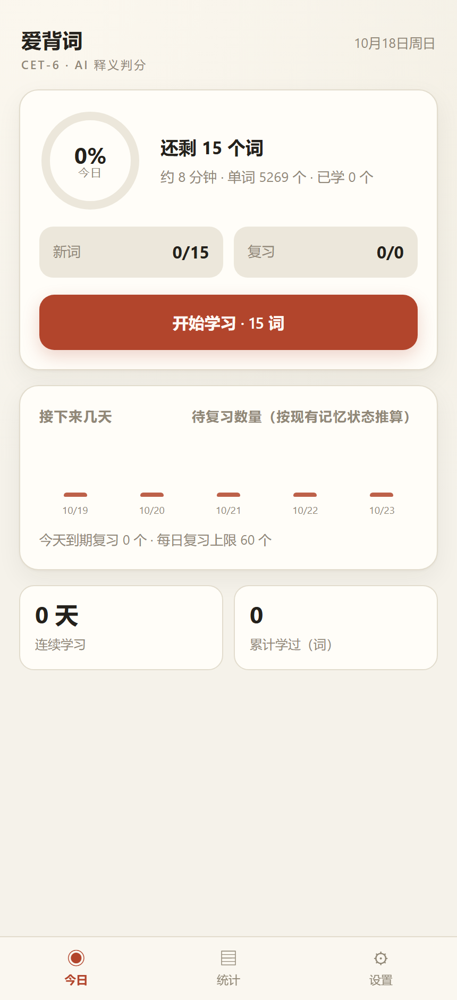
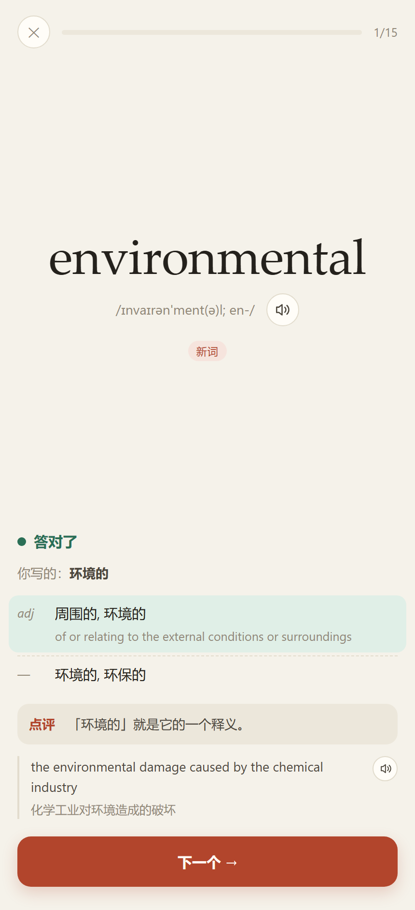
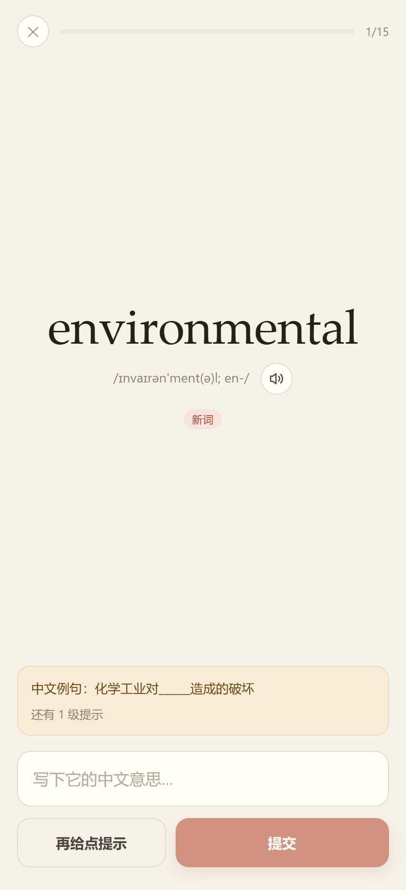
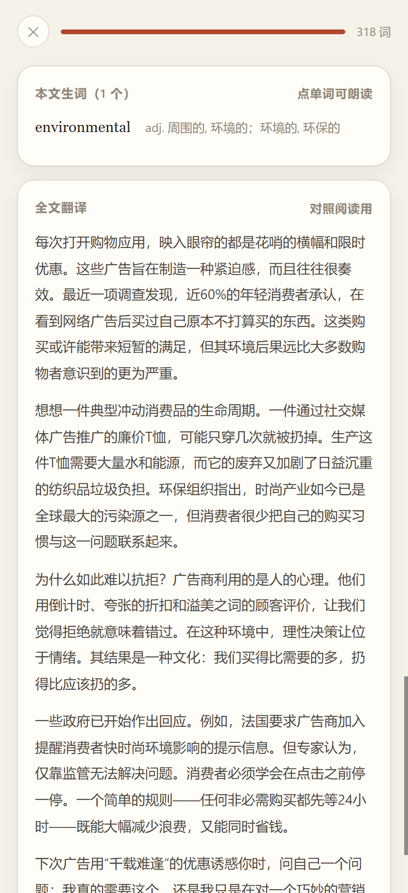
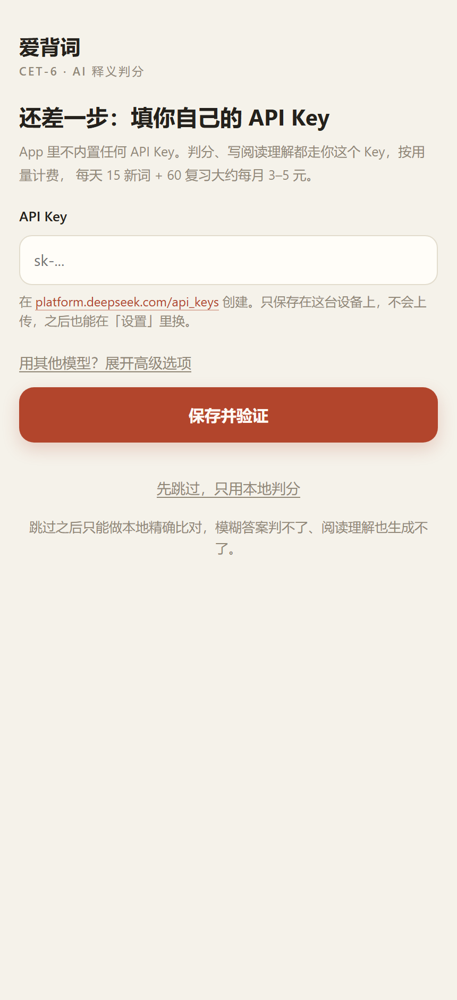
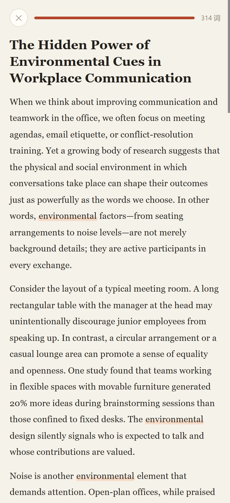

# 爱背词 · CET-6

[](https://github.com/future-people34/aibeici/actions/workflows/ci.yml)
[](LICENSE)

**看英文，写中文 —— 让模型判断你想起来的意思对不对，再按遗忘曲线安排复习，最后用当天学的词写一篇阅读理解。**

一个本地优先的六级背单词应用。词库和学习记录全在你的设备上，只有判分和生成文章时才联网调模型。
可作为 PWA 装在手机桌面，也可以打包成 Android APK 离线使用。

<p align="center">
  
  
  
  
</p>

## 它解决什么问题

主流背单词 App 让你做选择题 —— 那是「再认」，考六级要的是「产出」。这个应用只做一件事：
**屏幕上出现英文单词，你写出它的中文意思。** 你写的东西千奇百怪（近义词、错别字、一整句解释），
所以判分交给大模型按语义判断，而不是字符串比对。判完之后，再按你这次的表现更新这个词的复习间隔。

## 功能

- **看英文写中文，模型判语义**：判「对 / 部分正确 / 错」，给出命中的义项、点评和记忆提示。
- **词性必须对得上**：`environmental` 答「环境」判**部分正确**（那是名词 `environment` 的意思），
  应写成「环境的」。词库里 94 个词带这种「易混词根」标记。
- **每个词都有中文助记**：优先用真实构词法（`part（部分）+ cip（拿）+ -ant（人）→ 拿了一份的人 → 参与者`），
  词根不明显就给联想画面或常用搭配。**答对答错都会显示**，不依赖模型临时发挥。
- **提示是中文阶梯**：构词（`environment + -al`）→（有例句时）中文例句挖空（`化学工业对______造成的破坏`）→
  中文词义提示（`和周围自然条件有关的`）→ 答案。刻意不给首字母、字母数、音节数这种屏幕上已有的信息。
- **FSRS 复习调度**：每次作答更新记忆强度，间隔按目标保持率反算（10 分钟 → 4 天 → 14 天 → 44 天）。
  答错的词当天隔几个词重考一次；反复答错的词会被强行压短间隔。
- **学完自动生成阅读理解**：把当天的词尽量都写进一篇文章，出 5 道单选题（选项顺序本地打乱），
  **交卷后给出本文生词表和全文中文翻译**。
- **纯本地数据**：浏览器 IndexedDB，可导出 / 导入备份，可离线打开。
- **零 Key 内置**：仓库和安装包里不含任何 API Key，首次使用填自己的。

## 快速开始

### 用打包好的 APK（安卓）

从 [Releases](../../releases) 下载 `aibeici.apk`，传到手机安装（需允许「安装未知来源应用」）。
Android 7.0+，纯 Java 无 native 库，arm64 / armv7 通用。

首次打开会让你填自己的 API Key，填完当场校验一次，之后不再询问。
数据存在 App 自己的存储里，卸载即清空 —— 换手机前用「设置 → 导出备份」。

### 本地跑网页版

```bash
git clone https://github.com/future-people34/aibeici.git
cd aibeici
npm install          # 或 pnpm install
npm run dev          # http://127.0.0.1:5180
```

或者构建后跑生产模式（可安装为 PWA，需要 localhost 或 https）：

```bash
npm run build && npm run serve   # http://127.0.0.1:5181
```

Windows 上还有两个双击即用的入口：

| 文件 | 作用 |
|---|---|
| `启动爱背词.cmd` | 检查配置 → 按需构建 → 起服务 → 开浏览器；关窗口即停 |
| `打包安卓APK.cmd` | 缺工具链时自动下载 JDK + Android build-tools，然后打包 APK |

### 配置 API Key

不内置任何 Key。三种方式，任选其一：

1. **首次启动时按引导页填写**（推荐，桌面和安卓都一样）
2. 桌面版写进项目根目录 `apikey.txt`：`DEEPSEEK_API_KEY=sk-你的key`
3. 或者写进 `.env.local`，效果相同

Key 在 <https://platform.deepseek.com/api_keys> 创建。界面里也能换模型（任何 OpenAI 兼容接口都行）。

<p align="left">
  
</p>

## 每天怎么用

1. 首页显示今天的任务：新词 N 个 + 复习 M 个（计划当天只生成一次，刷新不会变）。
2. 点「开始学习」，逐个看英文写中文；实在想不起来点「不认识」看提示，提示用完才是答案。
3. 学完点「去读今天的文章」，做 5 道题，交卷后看生词表和全文翻译。

<p align="center">
  
</p>

复习量太大时系统会自动下调新词量（待复习 ≥ 上限 → 降到 1/3；> 80% → 减半；最近 3 天正确率 < 65% → 再打六折）。

## 判分怎么判（三层）

| 层 | 触发 | 成本 | 延迟 |
|---|---|---|---|
| L1 本地规则 | 命中词库义项 / 同义词 / 包含关系 | 0 | 0 |
| L2 本地拦截 | 猜测口吻（「好像」「是不是」）、单字、长句 → 交 L3 | 0 | 0 |
| L3 大模型 | L1 没命中的模糊表述 | ≈¥0.002/次 | ~1s |

实测 L1 覆盖 **97.3%** 的正确作答；拿别的词的答案来答，**99.8%** 会被拦下转给模型（400 次抽样的结果）。
L3 结果按「词 + 归一化答案」缓存，同一个答案只问一次。

## 复习怎么排（遗忘曲线）

调度用 [FSRS](https://github.com/open-spaced-repetition/free-spaced-repetition-scheduler)，它本身就是
艾宾浩斯曲线的数据拟合版：保持率 `R(t, S) = (1 + FACTOR·t/S)^DECAY`，记忆强度 `S` 由每次作答更新。

| 你的表现 | 评级 | 实测下次间隔 |
|---|---|---|
| 答错 / 直接看答案 | Again | 1 分钟后 |
| 部分正确 / 用了提示 | Hard | 5 分钟后 |
| 答对 | Good | 10 分钟后 |
| 秒答（<3 秒且复习过） | Easy | 十几小时到几天 |
| 之后继续答对 | Good | 4 天 → 14 天 → 44 天 → 125 天 |

- **当天重考**：答错的词隔 3 个词再考一次（同词最多 2 次、整场最多 12 次）。
- **易忘词保护**：答错 ≥3 次把间隔压回 7 天内，≥5 次压回 4 天内。
- **复习强度可调**（设置里三档目标保持率）：实测第四个词的间隔，紧凑 95% → 9 天，标准 90% → 44 天，
  宽松 85% → 136 天。
- **首次作答不给 Easy**：没见过的词按「秒答」最多给到 Good，不会一跳十几天。

## 费用

每天 15 新词 + 60 复习，大约 **¥3–5 / 月**（DeepSeek 价格）。统计页会显示当天调用次数和估算花费。
判分和写文章才花钱，词库、复习调度、离线查看都免费。

## 词库

5336 个六级词，其中 **1923 个六级增量词**（排除四级基础词），3413 个与四级重叠。
按词频排序，先学最常用的；每个词带音标、义项、变形、可接受答案键、中文词义提示、中文助记。

| 数据 | 来源 | 许可 |
|---|---|---|
| 词条、音标、中英释义、词频、词形变化 | [ECDICT](https://github.com/skywind3000/ECDICT) | MIT ✅ |
| 四六级词表（区分增量词用） | [KyleBing/english-vocabulary](https://github.com/KyleBing/english-vocabulary) | BSD-3-Clause ✅ |
| 词频 | [FrequencyWords](https://github.com/hermitdave/FrequencyWords) | MIT ✅ |
| 补充英文释义（1503 条）、中文词义提示、中文助记 | 本项目用模型生成（`enrich-*.mjs`） | MIT ✅ |
| ~~双语例句、同义词~~ | ~~[KyleBing/dict](https://github.com/KyleBing/dict)~~ | 该仓库**未声明许可证**，因此**未包含**在词库里，见 [NOTICE.md](NOTICE.md) |

重新构建词库（需要先下载原始数据，约 90 MB）：

```bash
npm run fetch:data      # 下载 ECDICT 与词表（约 90 MB）
npm run build:dict      # 生成 public/data/words.json（默认不含例句，许可明确）
```

`enrich:defs` / `enrich:hints` 是当初用模型补数据的脚本，结果已经提交在 `data/raw/`，
所以正常重建**不需要**再调模型、也不用花 Key。

想要例句与同义词：`node scripts/build-dict.mjs --rich` —— 那部分来自一个未声明许可证的仓库，请先确认授权。

## 技术架构

```
public/data/words.json        词库（约 3.2 MB，含判分答案键）
src/lib/judge.ts              三层判分引擎（本地规则 / 拦截 / 模型 + 缓存）
src/lib/srs.ts                FSRS 封装、评分映射、易忘词压制
src/lib/plan.ts               每日计划、到期筛选、复习雪崩防护
src/lib/reading.ts            阅读生成 + 校验（长度/目标词覆盖/题目结构）+ 选项打乱 + 全文翻译
src/lib/dict.ts               词库加载、发音（有道单词 / 百度句子 / 系统语音三级降级）
src/lib/llm.ts                模型调用（浏览器走本地代理，安卓走原生桥）
src/lib/native.ts             安卓原生桥的网页侧封装
server/llm-proxy.mjs          /api/llm → OpenAI 兼容接口的本地代理
scripts/serve.mjs             静态服务 + 代理
scripts/launch.mjs            一键启动器
scripts/build-dict.mjs        词库构建
scripts/enrich-{defs,hints}.mjs  用模型补数据
scripts/build-apk.mjs         免 Gradle 的 APK 打包（aapt2 → javac → d8 → zipalign → apksigner）
scripts/fetch-sdk.mjs         下载安卓工具链（不需要 Android Studio）
android/                      WebView 外壳：虚拟域名拦资源、原生 HTTP 桥、原生 TTS
```

**桌面版和安卓版的差异**：

| | 网页版 | APK |
|---|---|---|
| 资源 | 本地静态服务 | 虚拟域名 `https://app.aibeici.local` + `shouldInterceptRequest` 读 assets（`file://` 拿不到 IndexedDB） |
| 调模型 | `/api/llm` 走 Node 代理 | Java 原生 HTTP 桥，绕开 WebView 的 CORS |
| 系统语音 | `speechSynthesis` | 原生 `TextToSpeech` |
| Service Worker | 用于离线 | 关闭（资源本来就在本地） |

## 自测

```bash
npm test     # 判分规则、FSRS 调度、阅读校验、选项打乱、提示文案
```

覆盖的断言包括：本地判分召回率与误判拦截率、目标保持率对间隔的影响、易忘词压制、
首次作答不跳天、读音节/首字母不出现在提示里、选项打乱后答案下标与选项始终对应。

## 已知限制

- 判分和阅读理解需要联网调模型；没 Key 时只能本地精确比对（引导页可以「先跳过」）。
- 发音：单词用有道真人音频（只支持 20 字符以内）、句子用百度朗读（要求请求不带 Referer）、
  都失败才退回系统语音。系统语音念英文没声音通常是机器没装英文语音包。
- APK 打包脚本目前只支持 Windows（下载的是 Windows 版 JDK 与 build-tools）。
- 没有多端同步；换设备用「导出备份 / 导入备份」。
- 词库中个别条目大小写不规范（如 catholic），属上游源数据问题。

## 许可

代码 [MIT](LICENSE)。词库数据逐字段的出处见 [NOTICE.md](NOTICE.md)：随仓库提交的词库
**只用许可明确的来源**（ECDICT / FrequencyWords / BSD-3 的词表）+ 本项目用模型生成的释义与提示，
不含那个未声明许可证仓库的例句数据。

## 致谢

- [ECDICT](https://github.com/skywind3000/ECDICT) —— 英汉词典数据基础
- [ts-fsrs](https://github.com/open-spaced-repetition/ts-fsrs) —— FSRS 调度实现
- [FrequencyWords](https://github.com/hermitdave/FrequencyWords) —— 词频
- [KyleBing/english-vocabulary](https://github.com/KyleBing/english-vocabulary) —— 四六级词表
- [FrequencyWords](https://github.com/hermitdave/FrequencyWords) —— 词频
